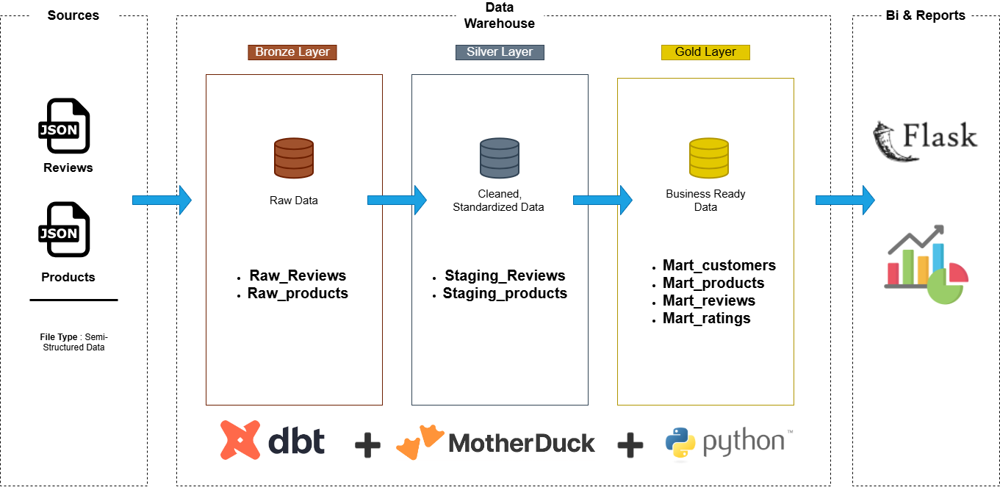
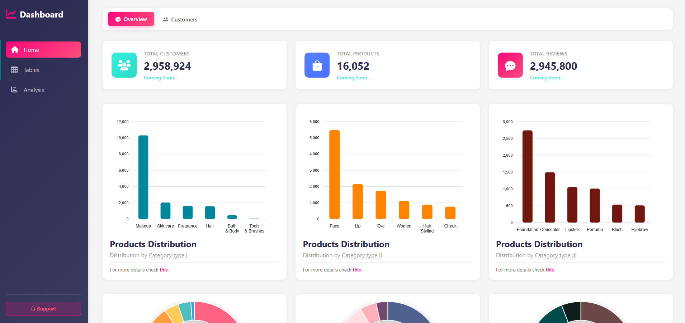

# Sephora Web Reviews Analysis

A data analytics project that organizes Sephora review data and presents it through a web dashboard. The project combines a Flask application with a dbt project, connecting data preparation and modeling with an interactive way to explore review data.



## 📝 Project Overview

Customer reviews can reveal patterns in product feedback, ratings, and customer sentiment. This project provides a foundation for exploring Sephora review data through a dashboard, with data-related project files organized separately from the web application.

As a data engineer, I designed the project to bring together the main stages of an analytics workflow:

1. **Data** — reviews and products data and stored in a database using `DuckDB`
2. **Transformation and modeling** — the `sephora_dbt/` directory contains the dbt project.
3. **Application** — `app.py` provides the Flask application entry point.
4. **Dashboard assets** — the `board/` directory contains dashboard-related project files.


## 🧩 Project Goals

- Make Sephora reviews data easier to explore.
- Present useful reviews insights in a web-based dashboard.
- Solid Data modeling work from application code.
- Demonstrate an end-to-end analytics project structure using Python, Flask, and dbt.

## 📂 Repository Structure

```text
.
├── app.py              # Flask application entry point
├── requirements.txt    # Python dependencies
├── board/              # Dashboard-related files
├── data/               # Requesting data from motherduck database
└── sephora\_dbt/        # dbt project
```

## 📊 Sephora Analytics Dashboard



- **Live Demo:** [Sephora Dashboard](https://sephora-web-analysis-app-kg8y.onrender.com)
- **Technologies:** Python, Flask, SQL, dbt, MotherDuck, JavaScript, ApexCharts
- **Features:** Product analytics, customer insights, brand comparisons, and review analysis

### Run Locally

1. Clone this repository.
2. Install the required dependencies.
3. Configure your MotherDuck connection.
4. Start the Flask application.
5. Open `http://127.0.0.1:5000` in your browser.
